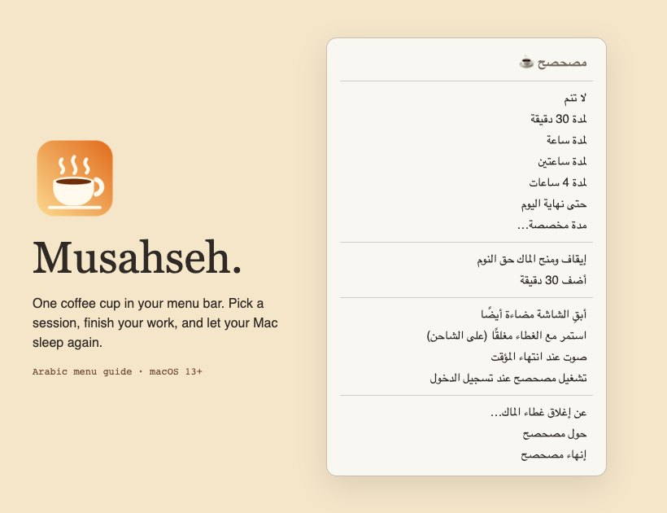

# Musahseh · مصحصح

An Arabic menu bar app for macOS that keeps a Mac awake for a download, a long-running task, or a presentation. Choose a duration from the coffee-cup menu. When the timer ends, Musahseh releases its power request and macOS resumes its usual sleep policy.



## Build and install

Requires macOS 13 or later and an Xcode toolchain with a macOS SDK (Xcode 15 or later recommended). The app uses system frameworks and has no external package dependencies.

```sh
git clone https://github.com/om7-sa/Musahseh.git
cd Musahseh
zsh build.sh
open build
```

Copy **مصحصح.app** from the build folder into Applications, then open it. Look for the small finjan in the menu bar. The build produces an ad-hoc-signed universal app for Intel and Apple Silicon; it is intended for local installation from source.

## Use the coffee menu

| Menu item | What it does |
| --- | --- |
| لا تنم | Start an indefinite session. Stop it yourself when finished. |
| لمدة … | Choose 30 minutes, 1 hour, 2 hours, or 4 hours. |
| حتى نهاية اليوم | Keep the Mac awake until the end of the current local day. |
| مدة مخصصة… | Enter 1–10,080 minutes (up to seven days). |
| أضف 30 دقيقة | Extend a running timed session by half an hour. |
| إيقاف ومنح الماك حق النوم | Release the current power request immediately. |
| أبقِ الشاشة مضاءة أيضًا | Keep the display on as well as the system. Leave this off for background work. |
| استمر مع الغطاء مغلقًا (على الشاحن) | Request continued operation on external power with the lid closed. macOS retains final control. |
| صوت عند انتهاء المؤقت | Play a sound when a timed session finishes. |
| تشغيل مصحصح عند تسجيل الدخول | Register the installed app to start at login. |

The menu bar icon reflects the active state. The menu shows the remaining time. The app can restore an unexpired saved session when relaunched. Quit from **إنهاء مصحصح** to end the current session and exit.

### About the lid

Normal sessions address idle sleep. Locking the screen and closing a laptop lid are different events. For the optional closed-lid setting, connect power, keep the Mac ventilated and enable the option before closing the lid. Hardware, thermal and battery conditions can still cause sleep. The app does not edit persistent power settings or require administrator access.

## Implementation and verification

The Swift/AppKit app uses ProcessInfo activity assertions, an optional IOKit PreventSystemSleep assertion and ServiceManagement for login startup. Preferences and timer state live in local UserDefaults. No accounts, analytics or network service are required.

| Path | Contents |
| --- | --- |
| Musahseh.swift | Menu, timers, preferences, login item and power management |
| AppIcon.svg, IconGenerator.swift and IconPacker.swift | Coffee-cup artwork and icon generation |
| AssertionSmokeTest.swift | Checks creation and release of a system power assertion |
| build.sh | Builds the universal executable and packages its app bundle |

```sh
mkdir -p build
swiftc AssertionSmokeTest.swift -o build/assertion-check
build/assertion-check
lipo -archs "build/مصحصح.app/Contents/MacOS/Musahseh"
codesign --verify --strict "build/مصحصح.app"
```

The smoke test checks the power-management API. Physical closed-lid behavior requires testing with the target Mac and power supply.
